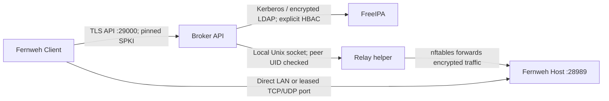

# Integrate the broker, directory and Hosts

The broker is an optional component of Fernweh. It is a FreeIPA/Kerberos
integration, not a turnkey identity provider or a generic OIDC/SAML/LDAP gateway.
Direct local PLANK connections do not require it. This guide uses reserved
example names; replace every identity, network and path with your own policy.

## Connections and trust



API authentication terminates at the broker. Media TLS/QUIC terminates at the
Host; the relay forwards encrypted packets and does not decode the desktop.
Client→broker trust uses administrator-distributed SPKI hashes. Broker→Host
probing pins the Host certificate; Client admission then verifies the exact
broker-provided Host leaf hash. Directory assignment and Host OS authorization
both remain necessary. A relay port alone does not authorize a desktop login.

## Prerequisites and build

Use a dedicated Rocky 9.7 Linux service machine with reliable time/DNS, reachable
FreeIPA KDC/LDAP servers, static network policy and an isolated test workstation.
MFA/password/passkey handling relies on FreeIPA's supported Kerberos flows;
verify your actual FreeIPA/SSSD versions and both OTP/passkey behavior before
exposing the endpoint. This repo does not ship BDE's directory installation or
custom KDC packages. Password+OTP is the initial integration path; passkeys and
remote enrollment can be enabled after their separate checks.

```sh
sudo dnf install gcc krb5-devel clang-devel pkgconf-pkg-config
cargo test --locked --release --manifest-path apps/broker/Cargo.toml
cargo build --locked --release --manifest-path apps/broker/Cargo.toml
```

The root Rust pin and Cargo lockfile select the toolchain/dependencies. The
`system` feature links MIT krb5/GSSAPI and uses LDAP SASL/GSSAPI. On macOS or a
source-only reviewer machine, use `cargo test --locked --no-default-features
--manifest-path apps/broker/Cargo.toml` for fake-backed logic tests. Those tests
do not replace native Linux/FreeIPA/relay acceptance.

## Directory policy

Use an administrative Kerberos session for these **one-time examples** on your
own test realm. Existing objects should be inspected and updated deliberately.
Do not copy a BDE inventory or make broad `allow_all` rules.

```sh
ipa group-add fernweh --desc='Fernweh remote users'
ipa hostgroup-add plank-remote --desc='Remote workstations'
ipa hostgroup-add-member plank-remote --hosts=ws1.example.org
ipa hbacsvc-add plank-remote
ipa hbacrule-add fernweh-artists
ipa hbacrule-add-user fernweh-artists --groups=fernweh
ipa hbacrule-add-host fernweh-artists --hostgroups=plank-remote
ipa hbacrule-add-service fernweh-artists --hbacsvcs=plank-remote
ipa service-add HTTP/broker.example.org
ipa service-add plank/ws1.example.org
ipa service-mod plank/ws1.example.org --auth-ind=otp
```

Hosts must exist in IPA, have directory DNS A records and, for Linux OS
accounts, the normal IPA/SSSD enrollment. Add intended users to the remote
group, configure their OTP authentication type and enroll their own factor
using your directory's administration/self-service flow. The broker computes
assignment from its configured hostgroup and **explicit enabled allow rules**;
`allow_all` and category-all rules do not create a broker assignment.

Set `ldap.hostgroup=plank-remote`, `ldap.hbac_service=plank-remote`,
`kerberos.host_service=plank`. Give the broker principal read/search/compare
access to directory DNS attributes (`objectclass`, `idnsname`, `arecord`,
`aaaarecord`), HBAC/group membership and relevant user policy. It needs **no
administrative password or general directory write permission**. For remote
enrollment, also grant read access to OTP ownership/disabled state under
`cn=otp,<base_dn>` (`objectclass`, `ipatokenuniqueid`, `ipatokenowner`,
`ipatokendisabled`, `managedby`) and user gate attributes (`krblastpwdchange`,
`krbpasswordexpiration`, `ipapasskey`, `ipauserauthtype`, `nsaccountlock`,
`memberof`). Never grant read access to `ipatokenotpkey`. Package these
read-only permissions in an IPA privilege/role assigned to the HTTP principal.

Provision separate keytabs once: `HTTP/broker.example.org@EXAMPLE.ORG` for the
API, `plank/ws1.example.org@EXAMPLE.ORG` for the Host. `ipa-getkeytab` can rotate
keys; do not repeatedly run it against an existing identity as a status check.
The broker needs realm/KDC mappings in `/etc/krb5.conf` (or its include directory),
`dns_canonicalize_hostname=false`, `rdns=false`, and the directory CA for
LDAPS/StartTLS. An LDAP bind alone is never proof of MFA.

For passkeys, configure the matching RP ID on broker and Client, install the
SSSD passkey Kerberos client plugin on the broker, and require/accept the intended
`otp` or `passkey` authentication indicator in both KDC and Host policy. Confirm
that your KDC preserves the OTP fallback when both methods are enabled.
Keep `[enrol] enabled=false` initially. Enable enrollment only after its group,
privileged-account exclusion, factor-presence, optional password-age and
self-service ACI gates pass. Password/token/passkey writes occur as the user,
not with the broker service principal.

## Service installation and runtime configuration

The deployable unit files and account definitions are shipped under
`apps/broker/packaging/`. Install the built binaries and unit definitions using
these paths; determine Cargo's output directory instead of assuming a private
maintainer path:

```sh
broker_target=$(cargo metadata --no-deps --format-version 1 \
    --manifest-path apps/broker/Cargo.toml | python3 -c 'import json,sys; print(json.load(sys.stdin)["target_directory"])')
sudo install -d -m 0755 /usr/local/libexec/plank-broker /usr/local/share/doc/plank-broker
sudo install -m 0755 "$broker_target/release/plank-broker" \
    "$broker_target/release/plank-broker-relay" /usr/local/libexec/plank-broker/
sudo install -m 0644 apps/broker/README.md /usr/local/share/doc/plank-broker/
sudo install -m 0644 apps/broker/packaging/sysusers.d/plank-broker.conf /etc/sysusers.d/
sudo systemd-sysusers /etc/sysusers.d/plank-broker.conf
sudo install -m 0644 apps/broker/packaging/systemd/*.service /etc/systemd/system/
sudo install -m 0644 apps/broker/packaging/sysctl.d/90-plank-broker.conf /etc/sysctl.d/
sudo install -d -o root -g plank-broker -m 0750 /etc/plank-broker
sudo install -o root -g plank-broker -m 0640 \
    apps/broker/packaging/broker.toml.example /etc/plank-broker/broker.toml
```

Edit the installed TOML **before starting services**: public endpoint, TLS paths,
realm, principal, directory CA/endpoints, allowed target CIDRs and enrollment
policy. Restrict relay destinations to actual workstation networks. Optional
`routing.direct_client_cidrs` selects office clients; routing is server policy,
not a Client-requested downgrade. Keep updates and diagnostics absent until
configured deliberately. For SELinux, apply normal `restorecon` to installed
binary paths as described in the [service reference](../../apps/broker/README.md#deploy-layout).

Generate/provision your own TLS key and certificate, keytabs and directory CA
outside Git. API keytab/TLS key: `plank-broker:root` mode 0400; configuration
`root:plank-broker` 0640; API state private 0700. The relay account must not read
the API's keys. The API has no capabilities; only the relay receives
`CAP_NET_ADMIN`. Use the supplied systemd sandboxes, not a root-run API service.

```sh
sudo -u plank-broker /usr/local/libexec/plank-broker/plank-broker check-config
/usr/local/libexec/plank-broker/plank-broker spki /etc/plank-broker/tls.crt
```

Distribute the verified public SPKI hash through the Client build settings or
administrator-controlled Client Settings. The example does not contain a usable
TLS identity or keytab. The first command also validates optional signing-key
access, so run it as the actual service user.

Network rules: clients reach API 29000/TCP and the configured relay port range
(default 29001–29100 TCP+UDP); broker reaches Hosts 28989 TCP+UDP and directory
Kerberos 88, password-change 464 and LDAP 636 (or 389 with mandatory StartTLS).
Persist IPv4 forwarding using the shipped sysctl file. Perimeter forwarding and
firewalld rules are administrator configuration; there is no automatic UPnP.
The relay owns only `inet plank_broker`; never flush unrelated nftables tables.
See [firewalld interaction](../../apps/broker/README.md#firewalld--nftables).
After confirming local firewall policy, load the specific sysctl file, reload
systemd and start relay before API. Do not enable another nftables service that
flushes existing rules on restart.

## Host admission

On a Linux test Host, install the fork's RPM and a root-owned 0600 keytab, then
set in `/etc/plank/host.conf`:

```ini
[security]
gssapi_keytab = /etc/plank/plank.keytab
gssapi_required_indicator = otp
gssapi_pam_service = plank-remote
```

Install the supplied `plank-remote` PAM account/session policy and authorize
that HBAC service. For a tested passkey deployment, the indicator list can be
`otp passkey`. MFA does not bypass OS account restrictions, root denial or
active-desktop ownership. Configure exclusive handoff/shared modes explicitly;
ordinary local-password PLANK access remains separate. Follow the Host's
[Linux GSSAPI contract](../../apps/host/linux/docs/plank-gssapi-admission.md).

For an unjoined shared Mac, use the complete
[signed-admission contract](../../protocol/macos-broker-admission.md): a separate
P-256 signing key private to the API, an exact directory-host→local-account
map and the corresponding public key installed in root-controlled Host config.
Directory HBAC assignment still applies. The Client cannot choose the local
account. An invalid capability never falls back to password/GSSAPI admission.
macOS signing, service setup and privacy permissions remain required.

## Acceptance and operation

Before allowing real users, verify an allowed and denied user, bad OTP, wrong
broker pin, changed Host certificate, expired/replayed device proof, direct
and relay routes, lease expiry/logout cleanup, API/relay restart and a real
Client session. Test password-only rejection at the KDC/Host, not only in the
UI. Use [the live acceptance contract](../../protocol/live-broker-acceptance.md)
and isolated credentials; fixture setup/teardown remains an explicit operator
action. This repository preparation runs no live fixture or deployment.

The CLI provides `pin list`, `pin reset <fqdn>`, `selftest directory --user
<user>` and `selftest kerberos --user <user> --host <fqdn>`. Reset a Host pin
only after independently verifying replacement identity. Keep audit logs and
session stores private; they contain operational metadata. Back up configuration
and key material securely. Test rotation/revocation rather than treating a
successful compile as proof of secure deployment.

## Admin socket

An optional, read-only status API for a local admin page. It is off unless
`[admin]` is configured (see the commented section at the end of
`apps/broker/packaging/broker.toml.example`).

- It listens on a Unix socket only, never on TCP. The broker is port-forwarded
  to the internet; this interface is not.
- Every connection is checked with the peer's uid before any request is read.
  Only the uid of `admin.api_user` (default `plank-admin`) is served, not even
  root. Other connections are closed without a reply.
- `admin.socket_group` (for example `plank-admin-api`) gives the socket and its
  directory to that group. The unit runs the broker with
  `SupplementaryGroups=plank-admin-api` and `RuntimeDirectory=plank-broker-admin`
  (mode 0750) so it may do that; add the API user to the group. The group is
  created by the shipped `sysusers.d` file.
- A socket or a user that cannot be set up stops the broker at start-up instead
  of leaving the feature silently off.

Endpoints (JSON, `Cache-Control: no-store`):

| Request | Reply |
| --- | --- |
| `GET /v1/admin/status` | `generated_unix`, `cache_ttl_secs`, `hosts[]` and `sessions[]`. Each host (every member of the directory's host group, assigned to anyone or not) has `id`, `name`, `online`, `busy`, `reason`, `pin_mismatch`, `checked_age_secs`, `connected_users[]`, `grants[]` (`user`, `route` relay or direct, `client`, `expires_in`) and, when set, `image_sha256`. Each session has `user`, `age_secs`, `idle_secs`. |
| `GET /v1/admin/users/{sam}` | `state` (`ok`, `disabled`, `not_found`), `groups[]` and `hosts[]`: what the broker itself would list for that user now, from the same caches sign-in uses. The name is folded to lower case like sign-in. |
| `POST /v1/admin/refresh` | Drops the directory view and user caches so the next request reads the directory again. Sessions, leases and probe results are untouched. |

There is no endpoint that ends a session, changes access or writes anything
else. Host status is what the periodic probe last saw (`checked_age_secs`); the
status call never probes.

## Host images

An optional small picture per host, shown on the client's host cards. Off unless
`[thumbnails] directory` is set.

- The file is `<directory>/<short host name in lower case>.png` (for
  `ws01.example.org`: `ws01.png`). The broker only reads the directory; whatever
  writes the files should write a temporary file and rename it into place.
- Accepted: a regular file (symlinks are not followed) of at most 128 KiB with a
  PNG signature and an IHDR chunk whose width and height are both 16 to 256
  pixels. Anything else is ignored and logged once per file version. The broker
  does not decode the image; clients decode it themselves and must check the
  size and hash again.
- Files are cached by (modification time, length). One `stat` per host per list
  call; the file is read again only when either changes.
- `GET /v1/hosts` adds `image_sha256` (hex SHA-256 of the file) to a host entry
  only when a valid image exists. Older clients ignore the field.
- `GET /v1/hosts/{id}/image` is authenticated exactly like `/v1/hosts` (bearer
  and, for device-bound sessions, the device proof). It answers 404 unless the
  host is in the caller's own list and has a valid image. The reply is
  `{"type":"image/png","sha256":"<hex>","data":"<base64>"}`, under 256 KiB, so
  clients reuse their pinned JSON path.

## Active Directory

The broker can use Active Directory instead of FreeIPA (`[directory] backend = "ad"`).
The FreeIPA backend is unchanged and stays the default. The complete AD example
config is the commented block at the end of `apps/broker/packaging/broker.toml.example`.

What changes with AD:

- **Sign-in** is the AD user name and password only: a plain Kerberos AS exchange
  against the domain controller (`kerberos.password_only = true`; no OTP, no FAST).
  The second factor happens on the Host's own sign-in. Passkey sign-in, the enrolment
  endpoints and `mac_admission` are not available (`enrol.enabled = false` is required).
  Every login's TGT is verified against the broker keytab (`kerberos.verify_principal`,
  `krb5_verify_init_creds` with `ap_req_nofail`), so a spoofed KDC cannot accept arbitrary
  passwords. See "Pin the KDCs" below.
- **Hosts** are the enabled computer accounts in the AD group `PLANK-Hosts`. A computer is
  listed only when its `dNSHostName` starts with its own name (computer names over 15 characters fail this, because `sAMAccountName` is truncated to 15: they are skipped until the DNS host name's first label is set equal to the account name); if two computers claim one
  host name both are dropped (logged).
- **Access** is by security groups: members of `PLANK-<COMPUTERNAME>` reach that host
  and members of `PLANK-AllHosts` reach all of them. Only security groups in
  `ad.groups_base` (an OU) count, and a group name that occurs twice grants nothing (logged).
  Nested groups count (the DC expands them with `LDAP_MATCHING_RULE_IN_CHAIN`). The user's
  primary group (Domain Users) is not visible this way: never use it for access. Disabled,
  expired, locked-out and password-expired users and disabled computers are refused, and a
  session created before the user's latest `pwdLastSet` is ended.
- **Admission** is `hosts.admission = "none"`: `connect` returns an empty `gssapi_token`
  and `auth_method: "host_login"`; the client then signs in on the leased relay port with
  its normal PLANK login. Hosts are probed by a TLS 1.3 handshake without a client
  certificate (`probe_mode = "tls"`). **In production set `[hosts.static_pins]`** (SHA-256 of
  each host's leaf certificate DER) **and/or `[ad.host_ipv4]`**: without them the first
  certificate seen is trusted (TOFU) and addresses come from DNS, so whoever controls DNS
  can redirect users.

### Account lockout and the broker limits

Every wrong password raises the account's `badPwdCount` in AD, which resets one observation
window `W` only after the *last* failure: failures chain, so spacing them out never helps
the account. The broker therefore mirrors AD's own counter. Per user (from any address) it
keeps `(count, last failure)`; it counts an attempt *before* asking the KDC, stamps it again
when the KDC has answered, allows one attempt per user at a time, and refunds the count when
the password was right, when the principal is unknown, or when the KDC could not answer
(unreachable, clock skew, TGT verification failed, account without AES keys). The count
resets only after `W + ad.lockout_margin_secs` (default 60 s, at least 10) without a counted failure; once
`N = limits.failures_per_user` wrong passwords are counted, that user is refused until then.
So at most `N` wrong passwords reach AD per quiet period, whatever their spacing. A sign-in
waits at most `kerberos.login_timeout_secs` (default 10) for the KDC; the attempt is counted
by its real outcome anyway.

Before the KDC is asked, the typed name must be an exact `sAMAccountName` of an enabled
person account (looked up over LDAP, cached for `ldap.cache_ttl_secs`). Anything else, such
as a UPN-prefix spelling the KDC would also accept, is denied without a KDC call and without
being tracked, so one account cannot collect several counts under different spellings. If the
lookup fails the sign-in is denied and not counted. A refusal by this per-user rule is never
visible as a 429: the client gets the normal challenge and then the same generic denial (after
`min_respond_ms`) as for a wrong password, so real and unknown names cannot be told apart.
Only the per-IP limits answer 429.

`ad.lockout_threshold` (`T`) and `ad.lockout_window_secs` (`W`) are required for the AD
backend and the broker refuses to start unless `N < T`. An example policy (`T = 5`, `W = 30 min`,
lockout duration 30 min, no fine-grained policies) uses `N = 3`; the two spare attempts cover
typos at the Windows sign-in (those count in AD but not here). A password spray can still keep
a user out of the broker (not of AD) for up to `W + margin` after the last wrong password.
`limits.block_secs` and `limits.user_window_secs` do not apply to this per-user rule.

The counters live in memory: a broker restart gives every user `N` fresh attempts. Do not
restart the broker in a loop, and remember `T - N` is the only reserve for that case.
Before going live check, on the LAN with a test account, that **one wrong password raises
`badPwdCount` by exactly 1** (`Get-ADUser <name> -Server (Get-ADDomain).PDCEmulator -Properties badPwdCount`): `badPwdCount`
is not replicated between domain controllers, so always query the PDC emulator, which the
authoritative count follows. The doubled count
UDP retransmissions can cause is avoided by `udp_preference_limit = 1` (TCP only, see the
`krb5.conf` below). Do not set `primary_kdc` / `master_kdc`: libkrb5 may retry a failed
password against the primary KDC, which would count twice.

### Setup for an administrator

1. **AD groups.** In one OU (`ad.groups_base`, for example `OU=PLANK,OU=Groups,DC=example,DC=org`) create the *security* group
   `PLANK-Hosts` (add each workstation's computer account), one security group
   `PLANK-<COMPUTERNAME>` per workstation (the computer's sAMAccountName without `$`) and
   optionally `PLANK-AllHosts`. Add users or groups to them.
2. **Broker VM.** Join it to the domain and create its keytab, as root on the VM:
   `adcli join --domain=example.org --login-user=<domain admin> --host-keytab=/etc/plank-broker/broker.keytab`
   (or `msktutil`), then `chown plank-broker:root` and `chmod 0400` the keytab.
   `kerberos.principal` is the machine account entry (`NAME$@EXAMPLE.ORG`); the broker
   binds to LDAP as exactly that principal (it takes a keytab ticket into its private
   in-memory credential cache at start-up and refreshes it). `kerberos.verify_principal` is a
   second keytab entry, `host/<broker fqdn>@EXAMPLE.ORG`. The machine account needs no special
   rights: default read access to the directory is enough. Run
   `plank-broker selftest directory --user <name>`: it first proves the keytab ticket works.
3. **Pin the KDCs.** `/etc/krb5.conf` on the VM names the domain controllers and switches
   DNS discovery off, so nobody can answer for the KDC:

       [libdefaults]
           default_realm = EXAMPLE.ORG
           dns_lookup_kdc = false
           dns_lookup_realm = false
           rdns = false
           udp_preference_limit = 1
       [realms]
           EXAMPLE.ORG = {
               kdc = dc1.example.org
           }
       [domain_realm]
           .example.org = EXAMPLE.ORG
           example.org = EXAMPLE.ORG

   Add one `kdc =` line per domain controller. No `primary_kdc` / `master_kdc`.
4. **LDAPS.** Put the root of the CA that signed the DC certificate (for example `CN=Internal-CA`) in `ldap.ca_cert`; the DC certificate already has SAN `dc1.example.org`. The LDAP URI host
   must be the DC's FQDN (`ldaps://dc1.example.org:636`), it names the `ldap/<fqdn>`
   principal, and **the certificate needs a Subject Alternative Name (dNSName) equal to that
   name**: a CN-only certificate is refused by rustls. Add an `/etc/hosts` line on the VM if
   DNS cannot resolve the name. The bind runs over TLS with channel binding, with no Kerberos
   security layer (works with LDAP signing negotiated, `LDAPServerIntegrity = 1`, and with
   channel binding left at the OS default).
5. **AES keys.** The domain functional level (2016) gives AES keys to accounts whose password was set since. Users must have AES Kerberos keys: AD accounts whose password was last set
   when only RC4 existed, or accounts restricted to RC4, fail with "no support for encryption
   type". The broker logs `etype_unsupported`, does not count it as a wrong password and
   still denies the sign-in: reset the user's password (and enable AES for the account).
6. **Firewall.** Forward one public IP to the broker VM: TCP 29000 (API) and TCP+UDP
   29001-29100 (relay leases, `relay.port_min/port_max`). The broker VM must reach each
   workstation on TCP+UDP 28989 and `relay.allowed_target_cidrs` must contain their network.
7. **Check.** `plank-broker check-config`, then start the service as for FreeIPA
   (see "Service installation"). Nothing in the config holds a secret: the keytab and
   TLS key are separate files.
